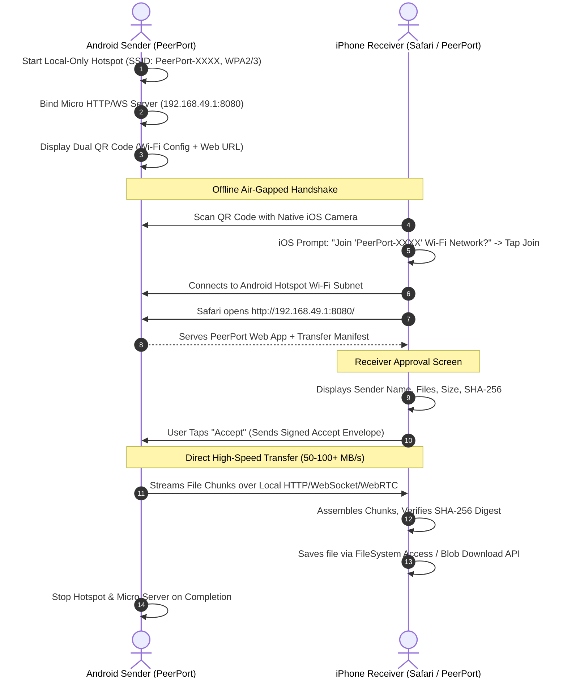

# PeerPort Architecture & Technical Specification

## Phase 1: Architecture Validation & Technical Feasibility

PeerPort is a cross-platform, privacy-first, direct peer-to-peer file-sharing application engineered to work across Android, iOS, Windows, macOS, and Linux. This document establishes the foundational architectural constraints, networking strategies, security guarantees, and execution roadmap, with special focus on **Scenario A: Direct Android-to-iOS sharing without internet**.

---

## 1. End-to-End Recommended Architecture

PeerPort is architected around a **Modular Capability-Based Transport Model**. Rather than hardcoding assumptions that every environment has identical networking capabilities, the system discovers runtime platform capabilities and attaches the optimal transport adapter.

```mermaid
flowchart TD
    UI[PeerPort UI\nReact 18 + TS + Tailwind + Zustand] --> Manager[Connection & Transfer Manager]
    Manager --> Abstraction[PeerTransport Interface]
    
    subgraph TransportAdapters [Transport Adapters]
        WebRTC[WebRTC DataChannel Transport\n(Internet-Assisted or LAN)]
        LocalHTTP[Local HTTP / WebSocket Transport\n(Hotspot / Offline Android-to-iOS)]
        QRBridge[QR-Assisted Signaling Transport\n(Manual Air-Gapped / Out-of-Band)]
    end
    
    Abstraction --> WebRTC
    Abstraction --> LocalHTTP
    Abstraction --> QRBridge
    
    subgraph Engines [Core Engines]
        Discovery[DeviceDiscoveryService]
        Transfer[TransferEngine: Chunking, Backpressure, SHA-256]
        FileMgr[FileSelectionService: Streaming, MIME, Sanitization]
        Security[Security & Authorization: Tokens, Nonces, PIN Approval]
    end
    
    Manager --> Discovery
    Manager --> Transfer
    Manager --> FileMgr
    Manager --> Security
```

### Component Topology

1. **Web Frontend (`apps/web`)**:
   - Modern React.js (v18+) with TypeScript in strict mode.
   - Vite for fast, reproducible bundling.
   - Tailwind CSS with system-applied Dark/Light theme toggle.
   - Lucide React for consistent icons.
   - Zustand for lightweight, decoupled reactive state management.
   - Zod for runtime schema validation of all protocol messages.
   - Web Crypto API (`crypto.subtle`) for streaming SHA-256 calculation.
   - Service Worker for offline PWA shell caching.

2. **Signaling Server (`apps/signaling-server`)**:
   - Node.js + TypeScript lightweight WebSocket server.
   - Coordinates WebRTC SDP offer/answer exchange, ICE candidates, and transfer metadata negotiation.
   - **Zero Payload Guarantee**: File payloads *never* pass through the signaling server.
   - Built-in rate limiting, room TTL expiration (5 minutes maximum idle), origin verification, and zero persistent storage.

3. **Native Companion / Local Offline Engine (`apps/native-companion`)**:
   - Lightweight companion daemon for Android / Desktop.
   - Provides Local SoftAP Hotspot control (via Android `WifiManager.startLocalOnlyHotspot` or desktop Wi-Fi APIs).
   - Embedded micro-HTTP/WebSocket server serving static PeerPort PWA assets and chunked local transfer endpoints.

4. **Shared Packages (`packages/`)**:
   - `packages/shared-types`: Canonical TypeScript definitions for sessions, manifests, chunk envelopes, transfer states, and protocol versions.
   - `packages/transfer-protocol`: Binary chunk framing, backpressure flow control, sliding window ACKs, and cryptographic checksums.
   - `packages/validation`: Strict Zod runtime parsers ensuring untrusted input cannot trigger memory exhaustion or logic flaws.

---

## 2. Proposed Android-to-iOS Offline Connection Method (Scenario A)

### The Real-World Engineering Reality
* **Wi-Fi Direct (`WifiP2pManager`)**: Supported on Android, **NOT supported on iOS**. Apple devices do not implement the Wi-Fi Alliance Wi-Fi Direct standard.
* **Apple Multipeer Connectivity (AWDL / AirDrop)**: Proprietary to Apple hardware and closed-source; Android cannot join Apple AWDL meshes without fragile, unsupported reverse-engineering.
* **Web Browsers (Safari / Chrome)**: Standard mobile browsers cannot listen on arbitrary TCP/UDP ports, cannot run an HTTP server, and cannot turn on OS hotspots.

### The Proven, Battle-Tested Solution: Local Hotspot + Micro-Server + Dual QR
This is the proven architecture used by industrial cross-platform apps (SHAREit, Zapya, AirDroid) and standardized for PeerPort:



1. **Step 1: Sender Local Hotspot Initiation**
   - The Android sender activates "Local-Only Hotspot" (`WifiManager.LocalOnlyHotspot`). This creates an isolated local Wi-Fi AP that does not require an active cellular or internet connection.
   - The Android companion/bridge starts an embedded local HTTP & WebSocket server bound to `192.168.49.1:8080` (the standard Android SoftAP gateway IP).
2. **Step 2: Dual QR Code Generation**
   - PeerPort displays a QR code formatted with standard Wi-Fi configuration URI:
     `WIFI:S:PeerPort-A8B2;T:WPA;P:k9#m2$xL;;`
     appended with the localized web entry point `http://192.168.49.1:8080/?token=AUTH_TOKEN`.
3. **Step 3: Zero-Install iOS Receiver Experience**
   - The iPhone receiver points the native iOS Camera app at the QR code.
   - iOS displays native system banner: *"Join 'PeerPort-A8B2' Wi-Fi Network?"*.
   - The user taps Join. The iPhone connects to the Android Wi-Fi network.
   - The user taps the link or opens Safari to `http://192.168.49.1:8080`.
4. **Step 4: Receiver Review & Transfer**
   - The iPhone browser loads the PeerPort interface directly from the Android local server (zero internet needed).
   - Receiver reviews the offered files (names, sizes, types) and taps **Accept**.
   - Chunks are transferred over high-speed local Wi-Fi via binary WebSocket / HTTP stream or local WebRTC DataChannel (using local host ICE candidates).
   - Complete file SHA-256 integrity is checked on-the-fly.

---

## 3. Internet-Assisted Fallback (Scenario B)

When both devices have active internet access (e.g. on different networks, mobile cellular data, or separate Wi-Fi routers):

1. **Signaling Connection**: Both peers connect to the PeerPort Signaling Server via secure WebSocket (`wss://`).
2. **Session Identification**: A cryptographically random 6-character room code (e.g. `PP-4829`) or secure deep link with an ephemeral session key is generated.
3. **WebRTC Negotiation**:
   - The sender generates an SDP Offer; signaling delivers it to the receiver.
   - The receiver generates an SDP Answer; signaling returns it to the sender.
   - STUN servers (`stun:stun.l.google.com:19302`) discover public IP/port candidates (host, srflx).
4. **Direct RTCDataChannel**:
   - A direct, DTLS-SRTP encrypted WebRTC DataChannel is established between the two browsers.
   - The signaling server is detached from the data path.
5. **Relay Transparency**:
   - If symmetric NAT / firewall prevents direct P2P, a TURN relay can act as intermediary.
   - **Mandatory UI Disclosure**: The UI clearly displays a shield status badge:
     - 🟢 **Direct Local / P2P**: Payload never touches any server.
     - 🟡 **Encrypted Relay**: Direct path unavailable; payload is end-to-end encrypted through a TURN relay.

---

## 4. Platform Capabilities: What React.js in a Browser Can & Cannot Do

| Capability | Browser React.js (Chrome/Safari) | Native Android / Companion | Native iOS |
| :--- | :---: | :---: | :---: |
| **WebRTC RTCDataChannel (P2P)** | ✅ Supported natively | ✅ Supported | ✅ Supported |
| **Streaming File Chunks (Memory-safe)** | ✅ `File.slice()`, `ReadableStream` | ✅ Native File I/O | ✅ Native File I/O |
| **Hardware SHA-256 Checksums** | ✅ `crypto.subtle.digest` | ✅ Native crypto | ✅ CryptoKit |
| **QR Code Generation & Scanning** | ✅ Canvas + `getUserMedia` | ✅ ML Kit / Native Camera | ✅ AVFoundation / Camera |
| **Offline App Caching** | ✅ Service Worker (PWA) | ✅ Native bundle | ✅ Native bundle |
| **Listen on TCP/UDP Sockets** | ❌ Blocked by browser sandbox | ✅ Supported (`ServerSocket`) | ✅ Network.framework |
| **Host an HTTP Server** | ❌ Blocked by browser sandbox | ✅ Supported (Micro-HTTP) | ⚠️ Foreground only |
| **Turn on Wi-Fi Hotspot (SoftAP)** | ❌ No browser API | ✅ `WifiManager.LocalOnlyHotspot` | ❌ Disallowed by iOS API |
| **Wi-Fi Direct (`WifiP2pManager`)** | ❌ No browser API | ✅ Supported | ❌ Disallowed by Apple |
| **Raw mDNS / Bonjour Multicast** | ❌ Disallowed in web JS | ✅ Supported | ✅ Supported |

### Architectural Conclusion
React.js is the **universal, high-performance UI and transfer engine** for both desktop and mobile web experiences. For Scenario A (offline Android-to-iOS without internet), React.js in iOS Safari connects effortlessly as a zero-install client, while Android utilizes the lightweight native/companion bridge to activate the local hotspot and micro-HTTP server.

---

## 5. Required Native Components

1. **Android Companion Layer (`apps/native-companion`)**:
   - Manages `LocalOnlyHotspot` lifecycle (`startLocalOnlyHotspot` / `stopLocalOnlyHotspot`).
   - Serves static assets and provides local WebSocket signaling over `127.0.0.1` / `192.168.49.1`.
   - Exposes clean JSON-RPC / REST endpoints to the shared React UI.
2. **iOS Client**:
   - **Zero native components required!** Safari running the React PWA provides full file streaming, chunking, hash verification, and file download capabilities.
   - An optional iOS Capacitor shell can be packaged for users wanting an App Store icon, but the browser fallback remains 100% operational without it.
3. **Desktop Companion (Windows/macOS/Linux)**:
   - Node.js local CLI / daemon script that can host local offline transfers or act as a local bridge when desired.

---

## 6. Proposed Signaling & Transfer Protocol

### Binary Chunk Framing Specification
All chunks sent over WebRTC DataChannel or WebSocket follow a fixed 32-byte binary header followed by raw payload bytes:

```text
+-------------------+--------------------+--------------------+--------------------+
| Magic (4 bytes)   | Version (2 bytes)  | MessageType (2 B)  | ChunkIndex (4 B)   |
| 0x50 0x50 0x52 0x54| 0x00 0x01          | 0x00 0x01 (CHUNK)  | uint32 BE          |
+-------------------+--------------------+--------------------+--------------------+
| TotalChunks (4 B) | PayloadLength (4 B)| SessionId (8 bytes / uint64 BE)         |
| uint32 BE         | uint32 BE          |                                    |
+-------------------+--------------------+--------------------+--------------------+
| Payload (Variable: 16 KiB - 64 KiB) ...                                         |
+----------------------------------------------------------------------------------+
```

### Transfer State Machine
```text
           [IDLE]
             │
             ▼
       [DISCOVERING] ──(Peer Selected)──► [CONNECTING]
                                               │
                                       (Session Secured)
                                               │
                                               ▼
                                      [AWAITING_APPROVAL]
                                        │             │
                                  (User Reject) (User Accept)
                                        │             │
                                        ▼             ▼
                                   [REJECTED]   [TRANSFERRING] (Backpressure Flow)
                                                      │
                                            (Integrity Verified)
                                                      │
                                                      ▼
                                                 [COMPLETED]
```

---

## 7. Security Threat Model (STRIDE)

| Threat Category | Potential Attack Vector | PeerPort Mitigation Strategy |
| :--- | :--- | :--- |
| **Spoofing** | Attacker impersonates a nearby peer or spoofed room ID. | Cryptographically generated 256-bit ephemeral session tokens; out-of-band visual PIN / QR verification code shown on both devices. |
| **Tampering** | In-transit payload modification or corrupted chunks. | Per-chunk framing checks + end-to-end SHA-256 digest validation of the complete assembled payload before file release. |
| **Repudiation** | Malicious sender claims file was sent / receiver denies acceptance. | Signed handshake receipts containing file metadata hash, timestamp, and peer session nonce. |
| **Information Disclosure** | Cloud sniffing of file contents. | Zero cloud payload policy. WebRTC uses DTLS-SRTP encryption; local Wi-Fi uses WPA2/WPA3 passphrase generated per session. |
| **Denial of Service** | Oversized file flooding or memory exhaustion. | Strict 64 KiB chunk streaming via `ReadableStream` with backpressure (`bufferedAmountLowThreshold`); JS heap never stores multi-gigabyte blobs. |
| **Elevation of Privilege** | Path traversal attacks via malicious filenames (e.g. `../../etc/passwd`). | Strict filename sanitization using `sanitizeFileName()`: strips directory separators, replaces non-alphanumerics, enforces length caps. |

---

## 8. Implementation & Testing Plan

### Phase Breakdown
- **Phase 1: Architecture Validation** (Completed with this document & threat model).
- **Phase 2: Core Foundation & UI System**
  - Setup monorepo (`apps/web`, `apps/signaling-server`, `apps/native-companion`, `packages/*`).
  - React 18, Vite, TypeScript strict, Tailwind CSS with Dark/Light theme toggle, Lucide icons, Zustand stores.
  - FileSelectionService with chunking simulator, file type categorization, drag & drop.
- **Phase 3: Transfer Protocol & Engine**
  - Binary framing serializer/deserializer with backpressure flow control.
  - Streaming SHA-256 hasher (`crypto.subtle`).
  - Vitest test suite verifying chunk reconstruction and corrupted chunk detection.
- **Phase 4: Signaling Server & Internet-Assisted WebRTC**
  - Node.js WebSocket signaling server with room lifecycle, rate limiting, and origin checks.
  - WebRTC DataChannel transport adapter.
- **Phase 5: Offline Hotspot & Zero-Install Browser Fallback**
  - Local HTTP micro-server & QR connection generator for Android/Desktop companion.
  - Safari receiver flow with native download trigger.
- **Phase 6: Security Hardening & Automated Tests**
  - End-to-end Vitest + Playwright verification.
  - File sanitization tests, timeout recovery tests, cancellation cleanup tests.

---

## 9. Operating Costs & External Services

| Service | Purpose | Provider / Technology | Estimated Cost |
| :--- | :--- | :--- | :--- |
| **Signaling Server** | WebRTC handshake & room coordination (JSON only) | Lightweight Node.js container (Fly.io / Render / VPS) | $0 - $5 / month |
| **STUN Server** | Public NAT discovery | Google Public STUN (`stun.l.google.com:19302`) | **Free ($0)** |
| **TURN Relay (Optional)** | Symmetric NAT fallback | Metered coturn / Open Source Coturn on VPS | $0 (Self-hosted) or pay-as-you-go |
| **Offline Sharing (Scenario A)** | Android to iOS direct transfer | Device-to-device local Wi-Fi Hotspot | **$0 (Zero infrastructure)** |
| **File Storage Cloud** | Payload storage | **None** (PeerPort never stores files in cloud) | **$0** |
